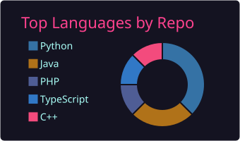
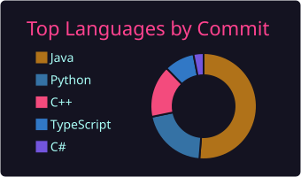

## 🌸 About me

- 🤖 Currently on my **[Advent of Agents](https://github.com/ctpnheee/advent-of-agents)** journey — building AI agents with Google ADK & Gemini, deployed on Vertex AI
- 📱 Building mobile apps with **Swift** and **React Native / TypeScript**
- 🗄️ Coursework in databases, algorithms and software design (Java, C#, C++)
- 🌱 Learning: multi-agent systems, cloud deployment, LLM tooling

## 🛠️ Tech stack

  
   
  

## 📊 GitHub stats

## 📌 Featured projects

| Project | Stack | Description |
|---|---|---|
| [advent-of-agents](https://github.com/ctpnheee/advent-of-agents) | Python · ADK · Gemini | Daily AI agent builds, from YAML agents to Vertex AI deployment |
| [WeeklyTodo](https://github.com/ctpnheee/WeeklyTodo) | Swift | iOS weekly planner app |
| [MobileApp_OpenWebUI](https://github.com/ctpnheee/MobileApp_OpenWebUI) | TypeScript | Mobile client for Open WebUI |
| [Library_DataFrame](https://github.com/ctpnheee/Library_DataFrame) | C++ | A DataFrame library written from scratch |
| [Mylittleclub](https://github.com/ctpnheee/Mylittleclub) | PHP | A mini social network website |

## 🤝 Connect

  
  

