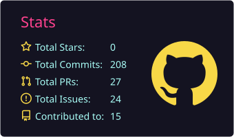
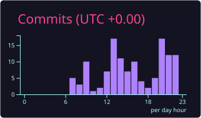
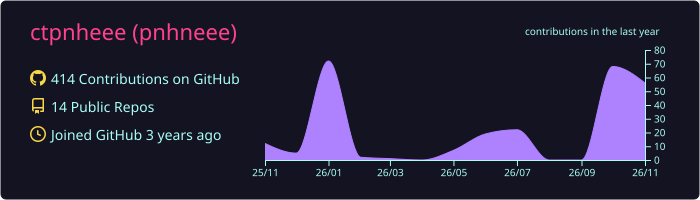

## 🌸 About me

- 🎓 Master of Engineering in Software Engineering & Information Systems at **EFREI Paris** (2025–2028), Bachelor in Computer Science from **Université Paris Cité**
- 🧪 Software Engineering Apprentice at **GE HealthCare France**, building Java/Tcl reliability test automation
- 🤖 Software Engineer at **[Tihado](https://github.com/tihado)**, building AI prototypes with LLMs, agents and MCP
- 🔭 Looking for an **AI Engineering internship** from July 2027 (4–6 months), open to relocating to Amsterdam
- 🌍 Vietnamese (native) · English · French

## 🏆 Hackathons

| Award | Event | Project |
|---|---|---|
| 🥇 1st Prize, Backyard AI Track | Build Small 2026 | [Pozify](https://github.com/tihado/Pozify) |
| 🥉 3rd Place + Sponsor Award | {Tech: Europe} Paris AI Hackathon 2026 | [Lumen](https://github.com/tihado/lumen) |
| 🥇 1st Prize, Creative Category | Agents & MCP Hackathon 2025 | Vidzly |
| 🥉 3rd Prize | AMD Robotics Hackathon 2025 | [EatAble](https://github.com/tihado/AMD_Robot_Hackathon) |

## 🛠️ Tech stack

  
   
  
   
  

## 📈 Contributions

<!-- CONTRIBUTIONS:START -->

| Year | Contributions | Commits | Pull requests | Issues | Reviews |
|:---:|:---:|:---:|:---:|:---:|:---:|
| 2026 | **225** | 122 | 27 | 24 | 0 |
| 2025 | **66** | 26 | 0 | 0 | 0 |
| 2024 | **69** | 60 | 0 | 0 | 0 |
| 2023 | **32** | 0 | 0 | 0 | 0 |

**Top repositories I contributed to**

| Repository | Commits | Pull requests |
|---|:---:|:---:|
| [ctpnheee/altn72-supervision](https://github.com/ctpnheee/altn72-supervision) | 44 | 18 |
| [Omar-Amaraa/DBMS_From_Scratch](https://github.com/Omar-Amaraa/DBMS_From_Scratch) | 52 | 0 |
| [ctpnheee/Library_DataFrame](https://github.com/ctpnheee/Library_DataFrame) | 31 | 0 |
| [tihado/nex-staff](https://github.com/tihado/nex-staff) | 14 | 8 |
| [ctpnheee/project_AI](https://github.com/ctpnheee/project_AI) | 17 | 0 |
| [tihado/Pozify](https://github.com/tihado/Pozify) | 8 | 1 |
| [ctpnheee/Project-Algo-Labyrinth](https://github.com/ctpnheee/Project-Algo-Labyrinth) | 6 | 0 |
| [ctpnheee/GestionOrdinateurs](https://github.com/ctpnheee/GestionOrdinateurs) | 6 | 0 |

Updated automatically on 2026-11-06. Private contributions are counted in the totals only.
<!-- CONTRIBUTIONS:END -->

## 🤝 Connect

  
  

