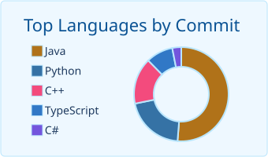
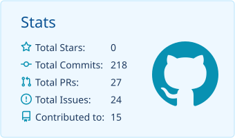
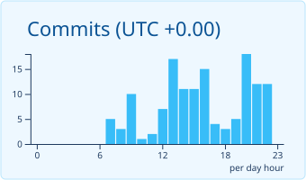
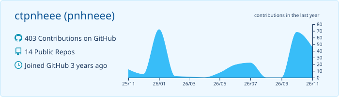

## 🐳 About me

- 🎓 Master of Engineering in Software Engineering & Information Systems at **EFREI Paris** (2025–2028), Bachelor in Computer Science from **Université Paris Cité**
- 🧪 Software Engineering Apprentice at **GE HealthCare France**, building Java/Tcl reliability test automation
- 🤖 Software Engineer at **[Tihado](https://github.com/tihado)**, building AI prototypes with LLMs, agents and MCP

## 🏆 Hackathons

| Award | Event | Project |
|---|---|---|
| 🥇 1st Prize, Backyard AI Track | Build Small 2026 | [Pozify](https://github.com/tihado/Pozify) |
| 🥉 3rd Place + Sponsor Award | {Tech: Europe} Paris AI Hackathon 2026 | [Lumen](https://github.com/tihado/lumen) |
| 🥇 1st Prize, Creative Category | Agents & MCP Hackathon 2025 | [Vidzly](https://github.com/tihado/vidzly) |
| 🥉 3rd Prize | AMD Robotics Hackathon 2025 | [EatAble](https://github.com/tihado/AMD_Robot_Hackathon) |

## 🛠️ Tech stack

  
   
  
   
  

## 🌊 Contributions

<!-- CONTRIBUTIONS:START -->

<!-- CONTRIBUTIONS:END -->

<picture>
  <source media="(prefers-color-scheme: dark)" srcset="https://raw.githubusercontent.com/ctpnheee/ctpnheee/output/ocean-snake-dark.svg" />
  
</picture>

## 🤝 Connect

  
  

